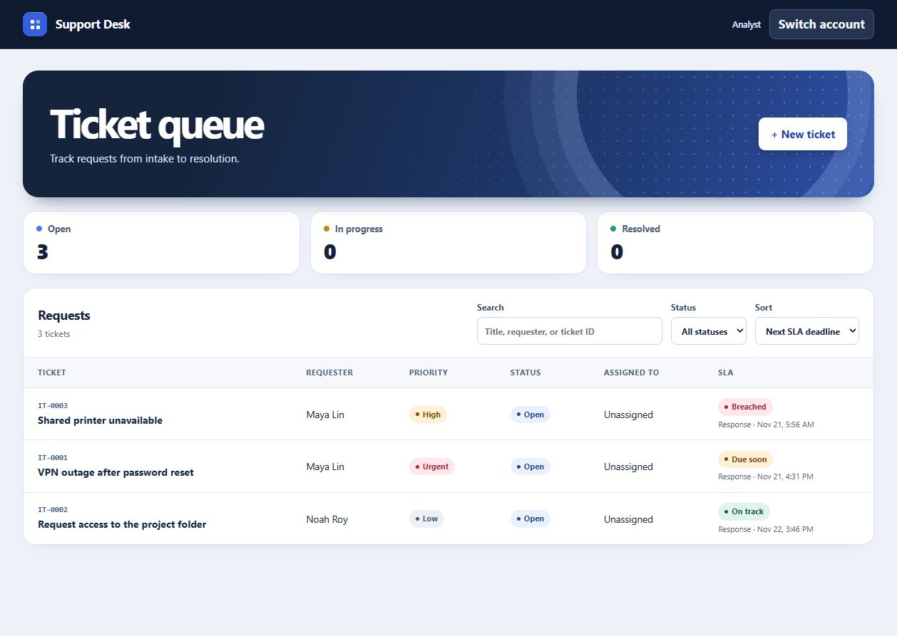
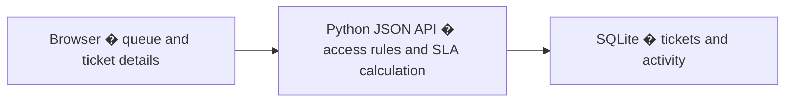

# Support Desk

**[Try the interactive demo](https://robcorbisiero.github.io/it-ticketing-system/)** � Choose Analyst, Maya, or Noah. Reset restores the fictional queue. All changes stay in your current browser page and disappear on refresh.

A local IT ticketing system for practising help-desk intake, triage, assignment, resolution, and reopening. Python serves the web interface and a JSON API. SQLite stores tickets and their activity history. No third-party Python packages or cloud services are needed.

## Run locally

From this folder, run `python app.py` and open [Support Desk](http://127.0.0.1:8091). The application creates an empty `tickets.sqlite3` database on first launch. Use `--database` to specify a separate database file.

## 90-second portfolio demo

[VPN incident walkthrough](docs/vpn-incident-walkthrough.md) shows how to triage, communicate, resolve, and reopen a fictional support ticket.

Run `python app.py --demo --port 8092` and open [the demo](http://127.0.0.1:8092). Demo mode seeds a separate fictional database on its first run and offers three selectable accounts. The demo identities and credentials are intentionally public. This is a localhost demonstration of access rules. Real deployments need individual accounts and production authentication.

1. Open the queue as **Analyst**. The shared printer incident is already breached. On a fresh demo database, the urgent VPN ticket is due soon and the routine folder access request is on track.
2. Open the VPN ticket. Assign an analyst, set **In progress**, add an internal note and a public reply, then resolve it. Inspect the two SLA milestones and the activity timeline.
3. Switch to **Maya**. Her ticket shows the public reply and status history. Switch to **Noah** to see his separate queue.

[Open the ticket detail screenshot](docs/ticket-detail.jpg)

## SLA policy

| Priority | First response | Resolution |
| --- | --- | --- |
| Urgent | 1 hour | 4 hours |
| High | 4 hours | 12 hours |
| Medium | 8 hours | 24 hours |
| Low | 24 hours | 72 hours |

Targets use elapsed time from ticket creation. The first move to **In progress** records the first response. Unfinished milestones become **Due soon** within one hour and **Breached** at the deadline. A completed milestone is **Met** if recorded by its deadline. Reopening preserves the first response and resumes the original resolution deadline. The queue sorts by the earliest unfinished deadline by default.

## Empty workspace walkthrough

1. Create a high-priority ticket for a fictional employee who cannot connect to the VPN.
2. Find the request by title or ticket ID. Assign an analyst, move it to **In progress**, and log a troubleshooting note.
3. Resolve it, then reopen it to **In progress** if the issue returns. Inspect the activity history and filter the queue by status.

The API validates input and allowed status changes. Each update and its activity entries are committed together. The server listens on the local machine. The default empty workspace runs in single-analyst mode. Use demo mode to exercise requester access.

## Verify the workflow

Run `python -m unittest -v` from the project folder. The tests use temporary SQLite databases and check the ticket lifecycle, SLA deadlines, requester isolation, and public reply visibility.

## CI and security

Pull requests run offline validation with read-only permissions. GitHub Actions dependencies are reviewed through Dependabot. See [security guidance](SECURITY.md).

The local server rejects foreign browser origins and non-local Host headers, limits JSON bodies to 16 KiB, and times out idle connections. This remains a local training application; public demo credentials are not production authentication.
