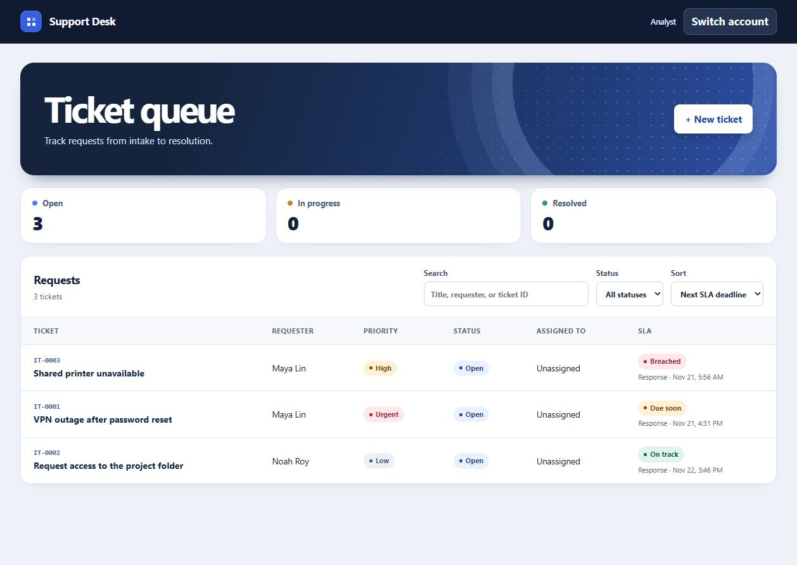

# VPN access incident walkthrough

**Scenario.** Maya, a fictional remote worker, loses VPN access after a password reset. This is a single-user incident with an urgent priority in the demo. The workflow below uses simulated troubleshooting and fictional data.

## Run the incident

Start with `python app.py --demo --port 8092` and open [the local demo](http://127.0.0.1:8092/). On a fresh database, the VPN response target is due soon. If the demo has been running long enough, the target will already be breached. A separate printer incident begins breached, so you can always demonstrate how overdue work is surfaced on a fresh run.

| Step | Analyst action | What to verify |
| --- | --- | --- |
| Triage | Open **VPN outage after password reset**. Check the requester, impact, priority, and SLA clocks. | An urgent ticket has a one-hour response target and a four-hour resolution target. Both are measured from intake. |
| Take ownership | Assign **Demo Analyst**, set **In progress**, and save. | The first response time is recorded, and resolution becomes the next unfinished deadline. |
| Record investigation | Add an internal note such as “Confirmed the issue affects one user. Asked requester to reconnect using updated credentials.” | The timeline records the note in the analyst view. |
| Communicate | Add the public reply “Please reconnect using your updated credentials and let us know if access is restored.” | Maya can read the reply and status changes. Her view hides the internal note. |
| Resolve | For this simulation, assume Maya confirms access. Choose **Resolved** and save. | The resolution time is recorded. Each SLA result reflects its own deadline. |
| Check access | Switch to **Noah** and search for the VPN ticket. | The VPN ticket is absent from his queue. The automated test also verifies that cross-requester detail access returns HTTP 404. |
| Reopen | Switch back to **Analyst** and move the VPN ticket to **In progress**. | The original resolution deadline resumes and the first response timestamp stays intact. |

## Evidence

[Ticket detail screenshot](ticket-detail.jpg) · [Automated verification](../test_app.py)

The screenshots show the fictional queue and ticket detail before triage. The walkthrough gives a reproducible way to demonstrate the ticket through resolution and reopening.
